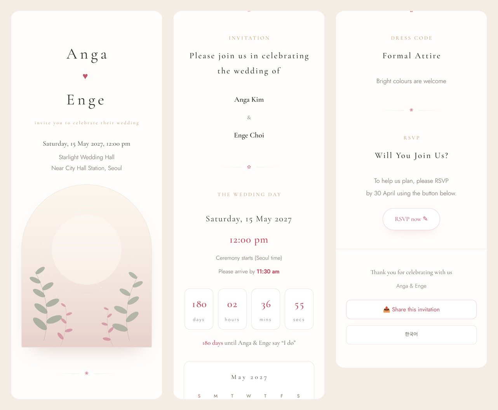

# Bilingual Mobile Wedding Invitation



> **한국어 안내는 [아래](#한국어)에 있습니다.**

A static mobile wedding invitation that builds a **Korean page and an English page from one config file**.
It was made for weddings where guests are split across two languages and two time zones — for example,
a wedding abroad with guests at home.

- Write names, date, venue, greeting, photos, bank accounts and RSVP link in **one file**: `invitation.conf`.
- Run `./build.sh` and upload the generated `dist/` folder to any free static host.
- Plain HTML, CSS and JS. No framework, no bundler, no server — only `bash`, `sed` and `awk`.
- Send each guest the link in their language: `/en` or `/ko`.

---

## What's inside

| Page | Contents |
|---|---|
| `en.html` | English invitation: invitation, wedding day with countdown and calendar, venue and map, dress code, RSVP |
| `ko.html` (`main.html`) | Korean invitation: the same design plus Korean conventions — family line, gallery and bank accounts (마음 전하실 곳) |
| `en-release.html` / `release.html` | Thank-you pages that unlock automatically once the ceremony has started |

**Features**

- **Time zones.** Dates, weekday and calendar follow the venue's local time. If a guest's device is in another
  time zone, an extra line shows the ceremony in their own time (e.g. *In Korea time: Sun 24 Jan, 2:30 pm*).
- **Arrival notice.** `ARRIVE_BEFORE_MIN` turns into *Please arrive by 11:30 am* automatically.
- **Google Maps.** A map embed from coordinates only — no API key needed.
- **RSVP.** Add a Google Form (or any) link and an RSVP button appears.
- **Bank accounts (Korean page).** Obfuscated so no plain account number exists in the output, drawn only when
  a guest opens the section. Fits 320px-wide phones, and the copy button works on plain http and in in-app
  browsers such as KakaoTalk.
- **Font presets.** Pick Korean and English font pairs in the config, or compare them live with `?fonts=1`.
- **Cover photo frame.** An arch, or a frame that keeps the photo's own ratio (great for photo-booth strips).
- **Empty means hidden.** Leave photos, accounts, RSVP, dress code, arrival notice or the English greeting body
  empty and the section disappears; the dividers between sections re-align themselves.
- **Thank-you page.** After the ceremony time, a link to the thank-you page appears on the cover.

---

## Make your own

### 1. Get the code and create your config

```bash
git clone https://github.com/MixedHyunsu/bilingual-wedding-invitation.git my-invitation
cd my-invitation
cp invitation.conf.example invitation.conf
```

Open `invitation.conf` and fill in your details. Every key has a comment explaining it (comments are in Korean;
the key names and the examples below are enough to follow along). The file is git-ignored, so it never gets committed.

### 2. Add photos

Put photos in `src/photos/` and list their file names in the config.

```ini
PHOTO_MAIN="cover.jpg"
PHOTO_MAIN_FRAME="auto"       # photo (keep ratio) | arch | auto (landscape → photo, portrait → arch)
PHOTO_GALLERY="g01.jpg,g02.jpg,g03.jpg"
```

The gallery pages through 9 photos at a time (3×3). Resize photos to roughly 1600px on the long side so they
load quickly on phones.

### 3. Build and preview

```bash
./build.sh                 # writes dist/
./startup.sh               # on your computer: http://localhost:8080/en.html and /ko.html
./startup.sh --lan         # also on your phone (same Wi-Fi) — the phone URL is printed
```

Run `./build.sh` again after every change to `invitation.conf` or `src/`.
Works on macOS and Linux; on Windows use Git Bash or WSL.

### 4. Choose fonts (optional)

Open any page with `?fonts=1` and switch font pairs from the bar at the bottom of the screen.
Put the id you like in the config:

```ini
FONT_EN="cormorant-jost"
FONT_KO="gowun-batang"
```

Presets live in `FONT_PRESETS` in `src/js/fonts.js`; add an entry to try a new pair. Google Fonts and
Fontshare are supported. The small English labels (THE WEDDING DAY, LOCATION …) on both pages follow the
English heading font.

### 5. Deploy (Cloudflare Pages, free)

1. Sign up at [Cloudflare](https://dash.cloudflare.com) and choose
   **Workers & Pages → Create → Upload your static files**.
2. Name the project and upload **the contents of `dist/`** — `index.html` must be at the top level.
3. Copy the URL you get (`https://<name>.pages.dev` or `https://<name>.<account>.workers.dev`) into
   `SITE_ORIGIN`, run `./build.sh`, and upload again to the same project. Link previews (KakaoTalk,
   WhatsApp, iMessage) need this to show your photo.

Any static host works (GitHub Pages, Netlify, …). Because `invitation.conf` is not in git, you always
**build on your computer and upload `dist/`**.

### 6. Share

| Link | Opens in |
|---|---|
| `https://<your-site>/en` | English |
| `https://<your-site>/ko` | Korean |

Both pages link to the other language at the bottom, and each shows a link preview in its own language.
`/` opens the language set in `DEFAULT_VERSION`.

---

## Customising

### Main config keys

| Key | What it does |
|---|---|
| `GROOM_NAME_EN`, `BRIDE_NAME_EN` / `GROOM_NAME`, `BRIDE_NAME` | English names (first last) / Korean names |
| `GROOM_PARENTS`, `GROOM_RANK_KO` | Family line on the Korean page |
| `WEDDING_AT`, `TIMEZONE`, `TZ_LABEL` | Ceremony time (ISO 8601 with offset) and the venue's time zone |
| `ARRIVE_BEFORE_MIN` | How many minutes before the ceremony guests should arrive |
| `GREETING_*_EN`, `GREETING_*_KO` | Greeting title, body and closing. `\n` = line break, `\n\n` = new paragraph |
| `VENUE_*`, `VENUE_NAME_EN`, `MAP_GOOGLE_URL` | Venue name (English name for the English page), address, coordinates, city and directions link |
| `INFO_*_EN`, `INFO_*` | Getting there, parking, reception notes |
| `DRESS_CODE_EN`, `DRESS_CODE` | Dress code; empty hides the section |
| `PHOTO_*` | Cover, bottom and gallery photos, and the cover frame |
| `RSVP_URL`, `RSVP_NOTE_EN`, `RSVP_NOTE_KO` | RSVP link and note (deadline etc.) |
| `GROOM_ACCOUNTS`, `BRIDE_ACCOUNTS` | Bank accounts on the Korean page: `name\|bank\|number`, comma-separated |
| `FONT_EN`, `FONT_KO` | Font presets |

### Colours

Colours are CSS variables in `src/css/main.css`: `--paper` (background), `--ink` (text), `--rose` (accent),
`--gold` (small labels), `--line` (lines) and so on. The cover frame uses `--photo-frame-line` and
`--photo-frame-shadow`.

### Fixed texts

Section titles ("The Venue", "오시는 길" …) and other texts that are not in the config live in
`src/en.html`, `src/main.html`, `src/en-release.html` and `src/release.html`. Keep the `{{TOKEN}}`
placeholders — they are replaced with config values at build time.

---

## Privacy

`.gitignore` keeps these out of git, so sharing or forking the repository never carries your details:

| Not tracked | Why |
|---|---|
| `invitation.conf` | Names, date, venue and bank accounts. Only the `.example` file is tracked |
| `src/photos/*` | Your photos. Only `demo-*.jpg` and the photo README are tracked |
| `dist/` | Build output, containing your photos and (obfuscated) accounts |

- Account obfuscation is **not encryption**; it keeps numbers away from search engines and scrapers.
- A deployed invitation is visible to **anyone who has the link**. Leave out anything you would not want shared.
- Everything in `src/photos/` is copied to `dist/photos/`. Remove unused photos before uploading.

---

## Troubleshooting

| Problem | Fix |
|---|---|
| Changes don't show | Run `./build.sh` again; on a phone, reload or open a new tab |
| Link preview shows an old version | Re-scrape the URL (e.g. [Kakao sharing debugger](https://developers.kakao.com/tool/debugger/sharing)) |
| Link preview has no photo | Set `SITE_ORIGIN` to your deployed URL, rebuild and upload again |
| `/en` doesn't open locally | Use `/en.html` and `/ko.html` with `./startup.sh`; short URLs work once deployed |
| Phone can't open the `--lan` URL | University or office Wi-Fi often blocks device-to-device traffic; try home Wi-Fi or a hotspot |
| Want to see the thank-you page early | Add `?preview=1` to its URL |

---

## Project structure

```
.
├── invitation.conf.example   Example config (fictional data)
├── build.sh                  Reads invitation.conf and turns src/ into dist/
├── startup.sh                Local preview of dist/ (--lan: also on your phone)
├── docs/preview.jpg          README preview (demo data)
└── src/                      Source with {{TOKEN}} placeholders only — no real data
    ├── main.html  en.html  release.html  en-release.html
    ├── css/                  main.css (invitation), developer.css (thank-you pages)
    ├── js/                   config.js (shared: language, time zone, map, share, copy), main.js,
    │                         fonts.js (font presets), private.js (bank accounts)
    ├── assets/               KakaoTalk share icon
    └── photos/               Your photos go here
```

---

## 한국어

**무엇인가요.** 설정 파일(`invitation.conf`) 하나로 **한국어 청첩장과 영어 청첩장을 함께** 만드는 모바일 웹 청첩장입니다.
해외 결혼식처럼 하객이 두 언어, 두 시간대에 나뉘어 있을 때를 위해 만들었습니다. 프레임워크나 서버 없이
결과물(`dist/`)을 무료 정적 호스팅에 올리면 됩니다.

**주요 기능.** 예식장 현지 시각 기준 날짜와 하객 시간대(예: 한국 시간) 안내 · 도착 시각 안내 · API key 없는 Google 지도 ·
RSVP 버튼 · 난독화된 계좌(한국어판)와 어디서나 동작하는 복사 버튼 · 폰트 조합 선택(`?fonts=1`) · 표지 사진 틀 선택 ·
비워 둔 섹션은 자동으로 숨김.

**만드는 순서**

```bash
git clone https://github.com/MixedHyunsu/bilingual-wedding-invitation.git my-invitation && cd my-invitation
cp invitation.conf.example invitation.conf   # 두 분의 정보로 고칩니다 (항목마다 한국어 주석)
./build.sh                                    # dist/ 생성
./startup.sh --lan                            # 컴퓨터와 휴대폰에서 미리 보기 (/ko.html, /en.html)
```

- 사진은 `src/photos/` 에 넣고 conf에 파일 이름을 적습니다 ([사진 안내](src/photos/README.md)).
- 폰트는 `FONT_KO`, `FONT_EN` 으로 고르고, 조합 목록은 `src/js/fonts.js` 에 있습니다.
- 색은 `src/css/main.css` 의 CSS 변수로 바꿉니다.

**배포와 공유.** `dist/` 안의 내용을 Cloudflare Pages(**Workers & Pages → Create → Upload your static files**) 같은
정적 호스팅에 올립니다. 받은 주소를 `SITE_ORIGIN` 에 적고 다시 build해서 올리면 카카오톡 미리보기에 사진이 나옵니다.
한국 하객에게는 `https://<배포 주소>/ko`, 영어권 하객에게는 `https://<배포 주소>/en` 을 보냅니다.

**개인정보.** `invitation.conf`, 사진, `dist/` 는 git에 올라가지 않습니다. 계좌 난독화는 암호화가 아니고,
배포한 청첩장은 주소를 아는 누구나 볼 수 있습니다.

---

## Credits

Based on [wedding-invitation-for-nerds](https://github.com/nerdkim/wedding-invitation-for-nerds) by
[NerdKim](https://nerd.kim/) (MIT). On top of the original design and build pipeline, this version adds the
English page, time-zone handling, Google Maps, RSVP, font presets and photo frames, and removes the developer
and terminal versions and the guestbook server.

## License

MIT — see [LICENSE](LICENSE). Fonts are loaded from Google Fonts and Fontshare under their own licenses.
